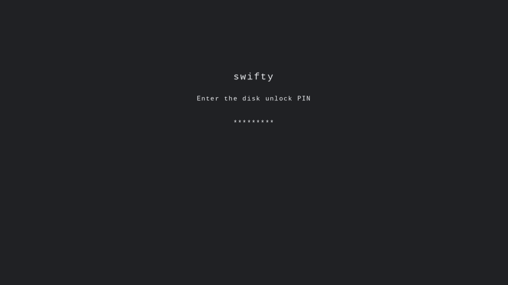
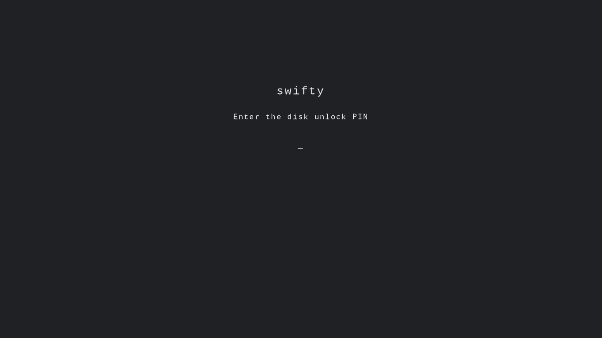
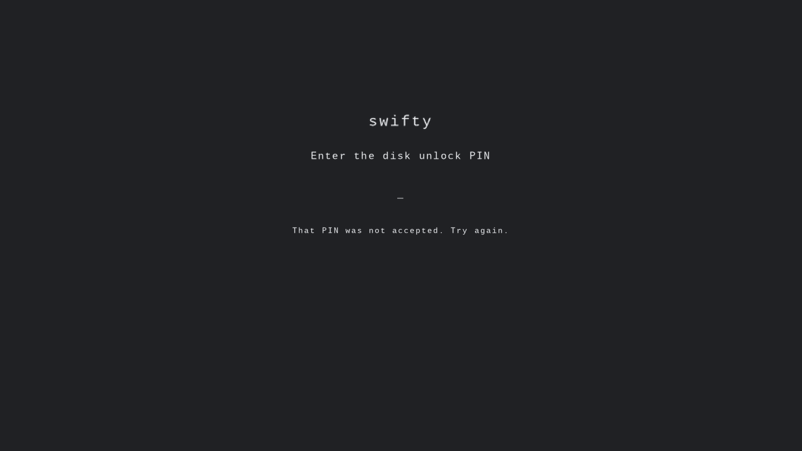

# Firmware disk unlock

An encrypted root filesystem with no initramfs has a circular problem: the
volume key must be known before there is a filesystem to read it from. The
kernel can map a dm-crypt device straight from its command line
(`dm-mod.create=`), but a key written there is published to every process
through `/proc/cmdline`.

Here the firmware supplies the key instead. depthcharge asks for a PIN, reads
the volume keys from the Cr50 (the machine's TPM), leaves them in a page of
memory it reserves, and tells the kernel where. The kernel installs them as
keyring keys that cannot be read back, maps the volumes, and discards them.
Boot goes from firmware to a mounted, encrypted root in under a second of
kernel time, with nothing in between to maintain.

It runs on one machine and has been its daily boot path since September 2026.
It is not a reviewed design. Read
[what it does not protect against](#what-this-does-not-protect-against) before
trusting it with anything.

## What it looks like



| Waiting for input | After a refused PIN |
|---|---|
|  |  |

These are renders, not photographs: the firmware's framebuffer cannot be read
back. They were computed from the firmware's own layout arithmetic and its font
bitmaps, at the panel's 1920x1080. Positions and sizes follow the code; the
anti-aliasing of the scaled glyphs is equivalent but not bit-identical.

## How it works

**In the Cr50.** The keys live in NV index `0x01500001`, 780 bytes: a count
followed by up to two entries of description (128 bytes) and key (up to 256
bytes). The index can only be read by satisfying its policy, which is
`PolicyPCR` over PCR0, PCR1 and PCR12, followed by `PolicyAuthValue`:

- PCR0 reflects the boot mode. Developer mode and recovery mode produce other
  values, so the index is closed in both.
- PCR1 reflects the hardware ID.
- PCR12 is zero at power-on. The firmware extends it immediately after the
  read, on every path including failures, so the index is closed again before
  the kernel starts. Nothing running later, root included, can read it until the
  next boot.
- The authValue is `SHA256("swifty-unlock-v1" || PIN)`. It is used as the key of
  an HMAC session, so the PIN itself is not sent to the chip.

The Cr50 offers neither `PolicyGetDigest` nor trial sessions, so the policy
digest is computed in software by [`tpm/swifty-enroll`](../tpm/swifty-enroll).

**In the firmware** (the vboot and depthcharge patches). When the kernel about
to be booted has `dm-mod.create=` on its command line, and the machine is in
normal mode, depthcharge draws a PIN prompt, opens a policy session, reads the
index, verifies the HMAC on the reply, and publishes the block twice in the
device tree: as a `/reserved-memory` node with `no-map`, and as
`/chosen/linux,dm-boot-keys` (a 64-bit address and a 64-bit length). The command
line is inside the signed kernel partition, so the same signature that covers
the kernel decides whether a PIN is asked for.

**In the kernel** (patch 6, `CONFIG_DM_BOOT_KEYS`). The early device-tree scan
takes the address and blanks the property. A `device_initcall` copies the block,
wipes the firmware's page, and installs each key as a `logon` key, a type with
no read operation. `dm-mod.create=` is parsed one initcall level later and finds
them by name (`:64:logon:swifty:root`). One level later still the keys are
revoked; dm-crypt has its own copy by then, and userspace has not started.

Checked on the running system: no key material in the kernel log, no handover
keys in `/proc/keys`, the handover page reserved and zeroed, the property absent
from the live device tree, and `dmsetup table` showing only the key's name.

## What this does not protect against

- **A probe on the Cr50's SPI bus during an unlock.** The session proves
  knowledge of the PIN and authenticates the reply, but it does not encrypt:
  the key block crosses the bus in the clear. Closing this needs a salted,
  encrypted session, which is not implemented.
- **PIN guessing, beyond how fast the machine restarts.** The Cr50 ships with
  dictionary-attack lockout disabled, and the one tested did not keep lockout
  parameters across a reboot: they read back correctly once set and were back
  to defaults after the next boot. The firmware allows three tries per boot,
  which bounds typos, not attackers. The debug UART also counts as a "trusted
  keyboard" to depthcharge, so with a debug cable guesses can be typed by a
  script. **Use a long passphrase, not a short numeric PIN.** Any printable
  ASCII up to 63 characters is accepted.
- **Modified firmware.** The policy binds the keys to the boot mode and the
  hardware ID, not to a measurement of the firmware. What prevents a firmware
  that records the PIN or the keys is verified boot itself: the read-only half
  is write-protected and the RW half must be signed with your key. Someone who
  can rewrite the write-protected flash with hardware access defeats both.
- **Root on the running system**, in two ways. `dmsetup table --showkeys` prints
  any dm-crypt volume key; that is true of every dm-crypt system. And the NV
  index sits in the owner hierarchy with empty authorisation, so root can delete
  or overwrite it: a denial of service, and a reason to keep a passphrase.
- **A powered-on or suspended machine.** The keys are in RAM, as with any disk
  encryption.

What it is good for: a machine that is stolen or examined while powered off.
The disk does not open without the PIN, on any other machine, or in developer or
recovery mode on this one.

## Setting it up

This is an outline of what was done, not a procedure to follow blindly. Rehearse
all of it on a scratch partition first; that is how every one of the mistakes
recorded below was found without losing data.

1. **Run your own firmware in normal mode** ([`firmware/`](../firmware)), with a
   kernel carrying patch 6 and the config in
   [`kernel/README.md`](../kernel/README.md#disk-unlock).

2. **Keep a way in that does not depend on the TPM.** Each LUKS volume needs a
   passphrase keyslot you have actually tested. The TPM copy disappears when CCD
   is opened, when the TPM is cleared, or when the index is deleted.

3. **Encrypt.** An existing ext4 partition can be converted in place, with the
   filesystem shrunk first to make room for the header:

   ```
   e2fsck -f /dev/mmcblk0pN
   resize2fs /dev/mmcblk0pN <size minus 32M>
   cryptsetup reencrypt --encrypt --type luks2 --reduce-device-size 32M \
       --cipher aes-xts-plain64 --key-size 512 --sector-size 4096 \
       --pbkdf argon2id /dev/mmcblk0pN
   ```

   Root has to be done from another system. On this machine 1 GiB took about 26
   seconds.

4. **Get each volume's dm table from cryptsetup**, not from memory: open the
   volume and run `dmsetup table`. Put it into `dm-mod.create=` with the key
   field replaced by `:64:logon:<description>`, as in
   [`kernel/cmdline.example`](../kernel/cmdline.example). Refer to partitions by
   `PARTUUID=`, and list the same partitions in `dm-mod.waitfor=`.

5. **Enrol**, on the machine, in normal mode, on a boot where PCR12 is still
   zero. That means a boot of a kernel partition *without* `dm-mod.create=`:
   once the machine boots the encrypted way, the firmware has closed the index
   before the OS starts, so enrolling again later means booting something else
   first, such as a rescue image.

   ```
   swifty-enroll check                  # proves the policy maths against the chip
   swifty-enroll enroll swifty:root=/run/root.key swifty:home=/run/home.key
   ```

   Each file holds a volume's raw key, which
   `cryptsetup luksDump --dump-volume-key --volume-key-file FILE DEVICE` writes
   out. Keep those files on a tmpfs and remove them afterwards. `enroll` reads
   the index back through a real policy session before it reports success.

6. **Sign a kernel partition with that command line**
   ([`kernel/build-kpart.sh`](../kernel/build-kpart.sh)), install it to the
   kernel slot that is *not* your known-good one with a single try, and reboot.
   A refused PIN or a wrong table then costs one failed boot, after which the
   firmware falls back to the other slot.

7. **Fix up userspace** as described in [`system/`](../system). Without it the
   root filesystem mounts and everything else waits ninety seconds for devices
   that udev never announces.

## Mistakes already made, so you need not

- **The keymap.** depthcharge reads the keyboard with a US layout unless told
  otherwise. A PIN typed under another layout in the OS and then at the firmware
  prompt can differ without looking different, and the result is an
  authorisation failure indistinguishable from a wrong PIN. Either stay within
  characters that sit on the same keys in both layouts, or give depthcharge your
  layout (the third depthcharge patch does this for Swedish).
- **`rootwait` without a number waits forever.** See `cmdline.example`.
- **`dm-mod.waitfor=` is not optional** with a root on eMMC.
- **The TPM index number.** tpm2-tools calls the index `0x01500001`; vboot's TPM
  library takes it without the handle-type byte, `0x00500001`, and adds the byte
  itself.
- **PCR12 is bound as zero, not as read.** Enrolment runs in the OS, after the
  firmware has capped PCR12 on a machine that already boots this way. Binding
  the value visible at that moment would seal the keys under a policy nothing
  can ever satisfy. `swifty-enroll` takes PCR12 as zero and refuses to run its
  read-back when it is not.
- **Opening CCD wipes the TPM**, and flashing firmware over the debug cable needs
  CCD open. Every firmware update is therefore followed by an enrolment, and
  preceded by checking that the passphrases work.
